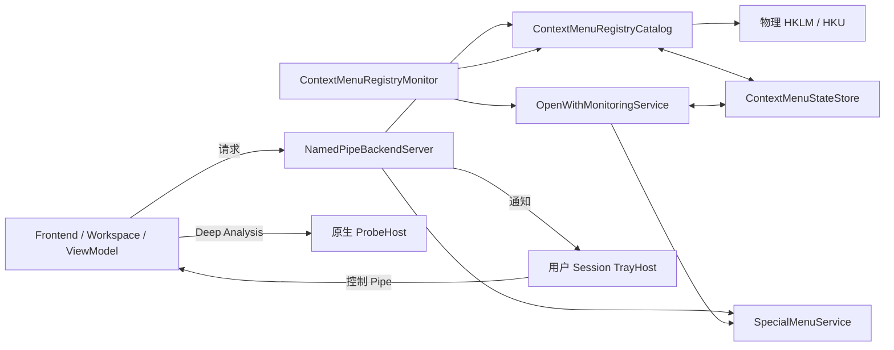

# 架构与模块职责

本文负责进程组合、源码入口与数据流。具体机制各有唯一主文档，任务导航见[文档索引](README.md)。

## 模块地图

[ContextMenuMgr.slnx](../ContextMenuMgr.slnx) 包含以下五个生产项目和 Tests。版本集中在 [Directory.Build.props](../Directory.Build.props)；项目中的实际 TFM、依赖和复制目标是构建事实。

| 模块 | 入口与输出 | 职责 |
| --- | --- | --- |
| Frontend | [App.xaml.cs](../ContextMenuMgr.Frontend/App.xaml.cs)、[App.Services.xaml.cs](../ContextMenuMgr.Frontend/App.Services.xaml.cs)；`ContextMenuManagerPlus.exe` | WPF/WPF-UI、DI/MVVM、导航、搜索、设置、Pipe 客户端；服务维护时启动 bootstrapper，深入分析时启动 ProbeHost |
| Backend | [Program.cs](../ContextMenuMgr.Backend/Program.cs)、[BackendRuntime](../ContextMenuMgr.Backend/Hosting/BackendRuntime.cs)；`ContextMenuManagerPlus.Service.exe` | LocalSystem 服务，组合 catalog、状态库、监控、SpecialMenu 和 Pipe server；同一 EXE 的 `--service-bootstrap` 是一次性提升入口 |
| TrayHost | [Program.cs](../ContextMenuMgr.TrayHost/Program.cs)、[TrayHostRunner](../ContextMenuMgr.TrayHost/TrayHostRunner.cs)；`ContextMenuManagerPlus.TrayHost.exe` | 用户桌面中的 Win32 托盘、通知与前端激活，不拥有注册表业务 |
| ProbeHost | [main.cpp](../ContextMenuMgr.ProbeHost/src/main.cpp)；`ProbeHost/<arch>/ContextMenuMgr.ProbeHost.exe` | 原生 C++、短生命周期 COM 探测；隔离第三方代码，不提权 |
| Contracts | [PipeEnvelope](../ContextMenuMgr.Contracts/PipeEnvelope.cs)、[ContextMenuEntry](../ContextMenuMgr.Contracts/ContextMenuEntry.cs) | DTO、IPC、路径、轻量控制客户端及共享日志基础设施；不承载注册表/WTS/UI 业务 |
| Tests | [项目](../ContextMenuMgr.Tests/ContextMenuMgr.Tests.csproj) | xUnit、真实临时注册表/状态文件与隔离子进程测试；不等于部署验收 |

## 组合与数据流

服务 `CreateDefault` 先迁移旧数据、best-effort 修复数据目录 ACL，再创建 logger、host identity、state/protection stores、catalog、SpecialMenu/OpenWith coordinator、Win11/AutoStart/scene/Explorer services、monitor 和 Pipe server。运行启动/停止由 [BackendWindowsService](../ContextMenuMgr.Backend/Hosting/BackendWindowsService.cs) 与 `BackendRuntime` 协调。具体启停、WTS 和通知所有权见[运行时生命周期](runtime-lifecycle.md)。

Frontend 取得单实例所有权后建立日志会话和 DI，启动控制 Pipe，创建主窗口并初始化 workspace。workspace 将连接可达性、主快照与 WPS 审核刷新分开：Ping 成功但快照失败属于数据加载错误，不自动升级为服务重装。分类页从 workspace 本地投影；scene-only 项不属于全局集合。详见[前端](frontend-wpf-ui.md)。

## 职责与持久化边界

| 责任 | 权威说明 | 关键所有者 |
| --- | --- | --- |
| 身份、权限、IPC 兼容 | [进程与权限](process-and-privilege-flows.md) | server、resolver、Contracts |
| baseline、审核、外部变化、schema/恢复 | [状态与监控](state-and-monitoring.md) | catalog、monitor、state store |
| 传统物理注册与恢复、写保护 | [注册表模型](registry-model.md) | catalog、mutation/ACL helpers、backup service |
| Packaged COM / SystemCommandStore | [Win11](windows11-context-menu.md) | Win11 catalog、blocks、impact index |
| 特殊入口 | [SpecialMenu](special-menus.md)、[ShellNew](shellnew.md)、[OpenWith](openwith.md) | SpecialMenuService 及专用 helper |
| 路径、数据 ACL、迁移、日志 | [运行时数据与日志](runtime-data-and-logging.md) | RuntimePaths、RollingLogFile、ACL repair |
| 发布与安装 | [构建发布](build-and-release.md)、[安装升级](installer-deployment.md)、[包管理器](package-managers.md) | PowerShell、Inno、Actions |

UI 显示状态、注册表物理状态、持久 desired/observed、认证 SID 和桌面 Session 是不同事实。任何“成功”说明都要指出验证到哪一层；Windows/外部平台未验收时不得由源码实现反推成功。

## 变更时维护

增加模块或调整入口更新本文；机制变化只更新上表对应主文档。未知故障从[排错](troubleshooting.md)收集证据，测试/兼容退休与完成清理遵循 [AGENTS](../AGENTS.md) 和[维护流程](maintainer-workflow.md)。
